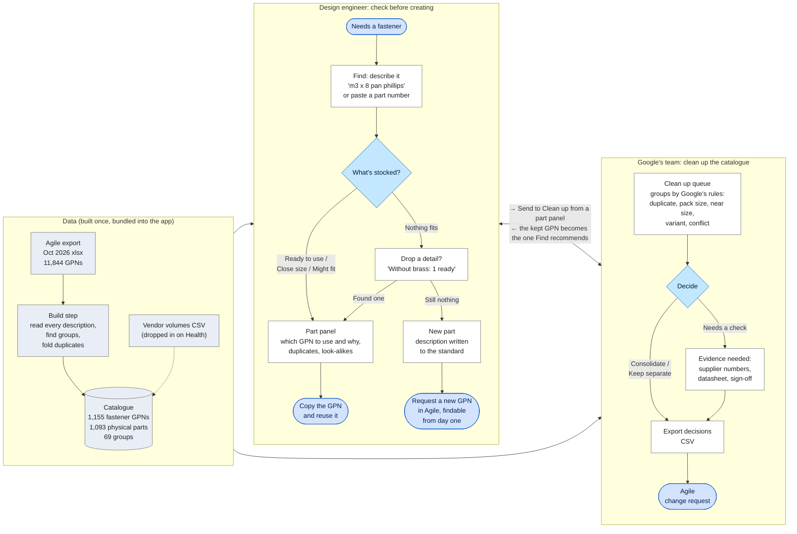

# Fastener Finder: workflow

How an engineer finds a part, how Google's team cleans up the catalogue, and where the data comes from. Everything runs in the browser: no backend, and nothing typed or loaded leaves the tab.

**Reading it**, left to right:

- **Data.** The Agile export is read once at build time: every description is parsed, GPNs that look like the same part are grouped, and duplicates are folded into physical parts. Vendor volumes, once Google sends them, are dropped in on the Health screen (dotted, because they're optional).
- **Design engineer.** Find shows what's already stocked, one row per physical part. The part panel says which GPN to use and why. If nothing fits, the page suggests which detail to drop, and only then offers a new part, with its description written to the standard.
- **Google's team.** Clean up lists every group by Google's rulings. Each decision is exported as a CSV for the Agile change request.
- **How the two connect** (the two-way arrow). An engineer can send a group from a part panel to the review queue. Once the team picks a GPN to keep, Find recommends that GPN to every engineer.
